<picture><source media="(prefers-color-scheme: dark)" srcset="assets/hero-dark.svg"></picture>

<a href="https://t.me/I_execute"><picture><source media="(prefers-color-scheme: dark)" srcset="assets/social-1-dark.svg"></picture></a>&nbsp;<a href="mailto:i_execute@icloud.com"><picture><source media="(prefers-color-scheme: dark)" srcset="assets/social-2-dark.svg"></picture></a>

<picture><source media="(prefers-color-scheme: dark)" srcset="assets/about-dark.svg"></picture>

<picture><source media="(prefers-color-scheme: dark)" srcset="assets/stack-dark.svg"></picture>

<picture><source media="(prefers-color-scheme: dark)" srcset="assets/stats-dark.svg"></picture>

<picture><source media="(prefers-color-scheme: dark)" srcset="assets/streak-dark.svg"></picture>

<a href="https://github.com/i-execute/OBHOD"><picture><source media="(prefers-color-scheme: dark)" srcset="assets/project-obhod-dark.svg"></picture></a>&nbsp;<a href="https://github.com/i-execute/Modules"><picture><source media="(prefers-color-scheme: dark)" srcset="assets/project-modules-dark.svg"></picture></a>

<a href="https://github.com/i-execute/Feroku"><picture><source media="(prefers-color-scheme: dark)" srcset="assets/project-feroku-dark.svg"></picture></a>&nbsp;<a href="https://github.com/HotaruProject/Hotaru"><picture><source media="(prefers-color-scheme: dark)" srcset="assets/project-hotaru-dark.svg"></picture></a>

